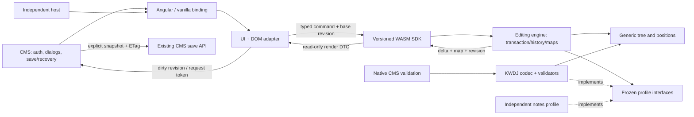

# Module boundaries and observable flows — M0 v2.0

Technical decider: primary Codex. The [architecture rationale](architecture.md), [registry](extensions-contract.md), [positions](unicode-positions.md), [UX](ux-contract.md), [inventory](cms-inventory.md) and [performance protocol](performance-protocol.md) are normative together. These are implementation contracts, not claims that M0 implements the engine.

## Modules, ownership and interfaces

Owner here names the implementation role and Linear task, not an invented staffed team. Артём retains human repository/release ownership; primary Codex owns architectural decisions.

| Module / role | Accepts → returns | Allowed dependencies and responsibility | Task |
| --- | --- | --- | --- |
| Document kernel / engine maintainer | Typed nodes, bounded descriptors → valid structural tree and positions | Rust std/Unicode; no DOM, CMS or concrete KWDJ import | OSR-29/33 |
| Profile registry / schema maintainer | Frozen exact versions + descriptor manifest → compiled registry, digest, capabilities/refusal | Kernel primitives; dependency order and complexity bounds | OSR-57/64 |
| KWDJ profile / profile maintainer | Bounded KWDJ bytes + wire version ↔ semantic tree, diagnostics | Implements kernel codec/validators; owns normative normalization/limits; no CMS persistence | OSR-29/30 |
| Editing engine / engine maintainer | Command envelope + selection → atomic result, changes, map, revision | Kernel + profile interfaces; write set, validation, history, stats and lifetime | OSR-33–38 |
| Native entry / CMS server maintainer | API document → profile validation/export result | Same kernel/profile source/corpus as WASM; auth/save/render stay CMS-owned | OSR-30/31/32 |
| WASM bridge / SDK maintainer | Versioned JS DTOs → typed results and opaque handle | wasm-bindgen + serde conversion; lifecycle, trap classification, no Angular types | OSR-63 |
| DOM adapter / browser maintainer | beforeinput/input/composition/selection → command; changes → keyed DOM | SDK only for model access; native layout/selection, composition protection, no direct state writes | OSR-39/40/41 |
| UI / interaction maintainer | Read-only capabilities + UI events → commands or host requests | DOM/SDK; slash, toolbar, keyboard move, DnD, theme/i18n and optional generic shell | OSR-42–44/48/66 |
| Clipboard / security maintainer | Captured bounded clipboard data → allowlisted fragment/diagnostics | Isolated parser + profile admission; never install foreign HTML/DOM; atomic insertion | OSR-47/67 |
| Vanilla binding / SDK maintainer | Container + config + host capabilities → mounted instance/destroy | No framework runtime required; async init, typed updates and events | OSR-65 |
| Angular binding / CMS frontend maintainer | Inputs/form lifecycle → vanilla instance | Angular peer dependency, OnPush-compatible events; no second semantic implementation | OSR-49 |
| Host services / CMS integration maintainer | Versioned request token → dialog/upload/reference result | Auth/network/product UI owned by host, validates stale tokens before dispatch | OSR-68 |
| Save/recovery / CMS integration maintainer | Dirty revision, snapshot, server receipt → dirty/saved/conflict/recovery state | Explicit exports; ETag/idempotency/unknown-outcome handling from CMS, no engine HTTP | OSR-69 |
| Delivery / release maintainer | Reviewed source + lockfiles + corpus pin → versioned package/artifact manifest | Build IDs/checksums, license provenance, native/WASM compatibility, clean external install | OSR-28/54/55/71 |

## Dependency diagram (editable source)



Arrows carry data or depend on an interface; a profile implements the generic interface, so the engine does not import a concrete KWDJ package. UI render DTOs are read-only. Native server and WASM use the same semantics, but the server remains authoritative for authorization, stored revision and reference existence.

## F01 — Successful edit and F02 — refusal

1. Adapter captures native selection and session/generation/base revision. For a supported cancelable non-composing beforeinput it prevents the browser mutation and dispatches a semantic command. For noncancelable/native changes it uses a bounded reconciliation path; it cannot pretend every beforeinput is cancelable.
2. Engine checks lifecycle, Unicode positions, capabilities and resource bounds; prepares a candidate write set. Profile normalization proposes bounded deterministic candidate operations, included in maps/inverses/limits; canonical fixed point is required. Then read-only core/schema/profile validators run deterministically. No committed node/history/revision changes during preparation.
3. Success publishes document + selection + map + history entry atomically and advances document revision once. After publication it emits the read-only change set; DOM patches only affected nodes and restores the mapped native selection. Host gets a dirty revision, not a full JSON snapshot per keystroke.
4. Expected refusal returns a typed code/path with unchanged document, selection, revision and history. For browser-mutated DOM, adapter restores the committed affected region while retaining recoverable provisional user input. UI explains the refused action and returns focus. A trap is fatal, not an ordinary validation refusal.

Tests: atomic rollback under every validator refusal, no subscriber reentrancy during partial commit, Unicode/limits, correct remapping and unchanged exported bytes on refusal. Owners OSR-34/37/39/63/67.

## F03 — Composition and unexpected native input

State machine: `idle → composing → settling → committed/refused`; fatal lifecycle paths leave editing disabled with recovery. Start captures base snapshot/range/tokens. During composition the browser owns provisional text in the bounded composing region; conflicting rerenders, typography and formatting/move commands do not overwrite it. Native composition remains usable. Mutation observations are evidence, not commands by themselves.

End schedules a bounded settle step and reads actual final DOM delta; `compositionend.data` is not authoritative and Escape/blur do not necessarily cancel. Safari empty end-data and Chrome untrusted end are recorded by OSR-58. Correlate trailing input with composition generation, compute one semantic replacement and dispatch exactly once. A selection spanning blocks must have an explicit reconciliation policy and production tests; the M0 paragraph replacement probe does not prove it. Tokens stale or bounds exceeded → retain provisional text for recovery and refuse the commit rather than overwrite a newer document. No guess based on event order alone. Owner OSR-41 with OSR-39/40/63/67.

## F04 — Undo/redo

Browser historyUndo/historyRedo and toolbar commands dispatch to engine history. The entry contains semantic inverse, deleted content and selection before/after. Undo restores content and original selection direction while advancing revision; redo advances again. Both return maps/deltas and one dirty event. They do not restore an old revision counter or run a second browser history. Composition/paste/move each form explicit groups; adjacent typing groups only under the contract. Refusal adds no history. Eviction/stale maps are observable. Owner OSR-36 with OSR-34/40.

## F05 — Dialog completion after editing or remount

UI captures a bookmark and `{session,generation,revision,selectionEpoch,requestId}` before focus leaves editor. Host owns product modal lifecycle and result. Close/cancel restores focus through a valid bookmark. Completion checks every required token: stale generation always refuses; stale revision/selection defaults to refusal with retained user dialog input. A command may explicitly opt into map-chain rebase only with all maps retained and no deleted/ambiguous target. A newer selection is never overwritten just because the old modal completed. Requests canceled on destroy cannot dispatch into a new handle. Owner OSR-63/68, UI OSR-42/66.

## F06 — Save, conflict and unknown outcome

```mermaid
sequenceDiagram
  participant E as Engine
  participant H as Host save/recovery
  participant S as CMS server
  E->>H: dirty revision 42
  H->>E: exportSnapshot(expected revision 42)
  E-->>H: bytes + revision 42 + profile/version
  H->>S: existing save contract + ETag + idempotency identity
  E->>H: dirty revision 43
  S-->>H: receipt for snapshot 42
  Note over H: Acknowledge 42; revision 43 stays dirty
  H->>S: next save with known server revision
  S-->>H: conflict / auth / timeout
  Note over H: Preserve local text and recovery; no silent retry-overwrite
```

Snapshot export is explicit and revision-tagged; if the required revision is unavailable return stale rather than label newer bytes as older. Host serializes/cancels save requests according to CMS policy, validates receipt identity and retains the snapshot until durable acknowledgement. A dirty-revision event is conservative: Undo-to-saved-content can clear user-visible dirty after explicit canonical snapshot equality with the saved baseline, without resetting the monotonically increasing revision or conflating it with server ETag. Conflict displays a recovery choice, never last-write-wins by accident. An uncertain network result requires status/read-back or an idempotent retry of the same operation; it is not proof the save failed. Auth loss, navigation and offline state retain local recovery data under host policy. Existing API/field formats and chapter/material recovery contracts remain pinned; no undocumented migration. Owner OSR-69/49/70/72.

## F07 — Initialization, incompatible artifacts and fatal failure

Async init loads verified JS/WASM version pair and checks ABI/profile/corpus identities before opening. Loading UI is noneditable and original source bytes stay owned by host. Network/CSP/compile/instantiate/ABI mismatch produces a typed failure with retry/export-original recovery, not a blank editable document. Real CMS CSP is a separate OSR-31 gate; the empty-WASM spike only demonstrated a representative policy.

After a runtime trap the handle is poisoned. Stop new commands, preserve the last coherent snapshot plus bounded provisional DOM input, notify host and offer recovery into a fresh generation after explicit user action. Memory exhaustion cannot be promised recoverable inside a trapped WASM instance; durable recovery must exist outside it. Destroy cancels listeners/requests, releases handles and prohibits late callbacks. Owner OSR-63/67/31.

## Evolution and fixed limits

Profile schemas/codecs can evolve through exact versioned migration and corpus parity. TextStore, indexes and DTO converters can change behind their boundaries; they still require performance/correctness regression checks. A Worker changes command latency, ownership and cancellation contracts, so it needs an ADR rather than a hidden implementation switch. Virtualization affects Find, selection, clipboard and composing nodes and must pass OSR-46 against full DOM. CRDT collaboration needs durable identity and conflict semantics beyond local maps. Mobile/CJK/real AT require dedicated native acceptance; no current abstraction automatically proves support.

The constraints established now are lossless admission or refusal, one semantic authority, no partial commit, explicit session lifecycle, pinned behavior, bounded work, and host ownership of persistence. They allow future optimization while preventing an optimization from quietly changing the document contract.
