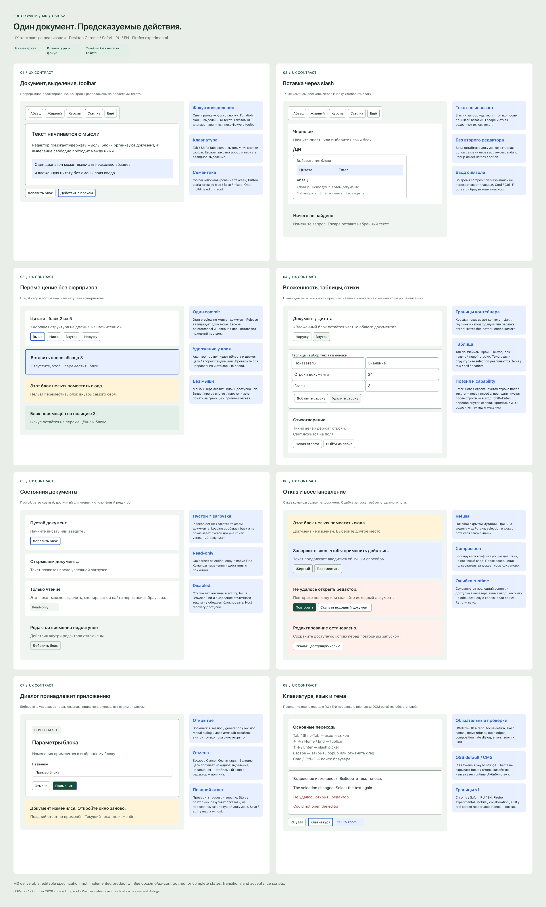

# OSR-62 — UX specification evidence

Versioned design specification for the planned editor. This does **not** claim a working UI, browser acceptance or real screen-reader support.

[Editable Figma file](https://www.figma.com/design/4Mkb3kl1RU3wV5H1hNYH7S) · [UX contract](../../docs/m0/ux-contract.md) · [Machine-readable frame map](figma-manifest.json)

| Frame | Behaviour | Implementation tasks | Keyboard acceptance |
| --- | --- | --- | --- |
| [01 · Документ, выделение, toolbar](https://www.figma.com/design/4Mkb3kl1RU3wV5H1hNYH7S?node-id=3-44) | Документ, выделение, toolbar | [OSR-42](https://linear.app/klenwriter/issue/OSR-42), [OSR-40](https://linear.app/klenwriter/issue/OSR-40), [OSR-39](https://linear.app/klenwriter/issue/OSR-39) | UX-K01, UX-K02 |
| [02 · Вставка через slash](https://www.figma.com/design/4Mkb3kl1RU3wV5H1hNYH7S?node-id=3-112) | Вставка через slash | [OSR-43](https://linear.app/klenwriter/issue/OSR-43), [OSR-42](https://linear.app/klenwriter/issue/OSR-42) | UX-K03 |
| [03 · Перемещение без сюрпризов](https://www.figma.com/design/4Mkb3kl1RU3wV5H1hNYH7S?node-id=3-173) | Перемещение без сюрпризов | [OSR-44](https://linear.app/klenwriter/issue/OSR-44), [OSR-42](https://linear.app/klenwriter/issue/OSR-42), [OSR-40](https://linear.app/klenwriter/issue/OSR-40) | UX-K04, UX-K10 |
| [04 · Вложенность, таблицы, стихи](https://www.figma.com/design/4Mkb3kl1RU3wV5H1hNYH7S?node-id=3-226) | Вложенность, таблицы, стихи | [OSR-50](https://linear.app/klenwriter/issue/OSR-50), [OSR-51](https://linear.app/klenwriter/issue/OSR-51), [OSR-52](https://linear.app/klenwriter/issue/OSR-52) | UX-K05 |
| [05 · Состояния документа](https://www.figma.com/design/4Mkb3kl1RU3wV5H1hNYH7S?node-id=3-312) | Состояния документа | [OSR-63](https://linear.app/klenwriter/issue/OSR-63), [OSR-67](https://linear.app/klenwriter/issue/OSR-67), [OSR-66](https://linear.app/klenwriter/issue/OSR-66) | UX-K08 |
| [06 · Отказ и восстановление](https://www.figma.com/design/4Mkb3kl1RU3wV5H1hNYH7S?node-id=3-357) | Отказ и восстановление | [OSR-41](https://linear.app/klenwriter/issue/OSR-41), [OSR-67](https://linear.app/klenwriter/issue/OSR-67), [OSR-69](https://linear.app/klenwriter/issue/OSR-69) | UX-K06, UX-K08 |
| [07 · Диалог принадлежит приложению](https://www.figma.com/design/4Mkb3kl1RU3wV5H1hNYH7S?node-id=3-423) | Диалог принадлежит приложению | [OSR-68](https://linear.app/klenwriter/issue/OSR-68), [OSR-42](https://linear.app/klenwriter/issue/OSR-42), [OSR-40](https://linear.app/klenwriter/issue/OSR-40) | UX-K07 |
| [08 · Клавиатура, язык и тема](https://www.figma.com/design/4Mkb3kl1RU3wV5H1hNYH7S?node-id=3-466) | Клавиатура, язык и тема | [OSR-66](https://linear.app/klenwriter/issue/OSR-66), [OSR-45](https://linear.app/klenwriter/issue/OSR-45), [OSR-71](https://linear.app/klenwriter/issue/OSR-71) | UX-K01, UX-K09, UX-K10 |

## Review and provenance

- 8 frames, each 1220×940; review wrapper 2600×4316. Final composition exported at 2468×4096.
- Figma read-back: 177 editable text nodes, 34 linked component instances, 115 layout frames, zero image-filled nodes. This is editable design content, not a screenshot pasted into Figma.
- Font assertion: all text SF Pro, the Mac rendering of the system UI font used in the source prototype. No production font/library dependency is introduced.
- Source discovery: no Code Connect files and no existing screens in the new file. Simple Design System Button/Input Field components reused; source-aligned neutral semantic tokens, scoped colour/spacing variables and shared SF Pro text styles added. Theme choice is an OSS default, not a fixed CMS brand.
- The initial automatic layout had collapsed text heights and horizontal rows. A targeted sizing correction restored wrapping and row heights; the repaired full composition was visually inspected. No visible clipped or overlapping text remains in the reviewed export.
- Root architect approved the eight-frame plan, host-owned product dialogs, selection/version safeguards, table boundary exits and current KWDJ poetry parity. The final contract preserves those boundaries.
- The scenarios UX-K01–UX-K10 are acceptance scripts for subsequent implementation tasks. They have **not** been executed against a production editor in M0.

## Export

`ux-contract-overview.png` SHA-256: `a3ff1c6497f658a6180bbfcb907275d10cc28195d96ef1462c983d86503de7f9`.

## Scope limits

Chrome/Safari desktop and RU/EN are required v1. Firefox is experimental. Real assistive-technology acceptance, mobile, CJK guarantees and collaboration remain deferred. Figma semantics annotations are requirements, not measured accessibility outcomes. No private CMS source or user document was copied into the design.
